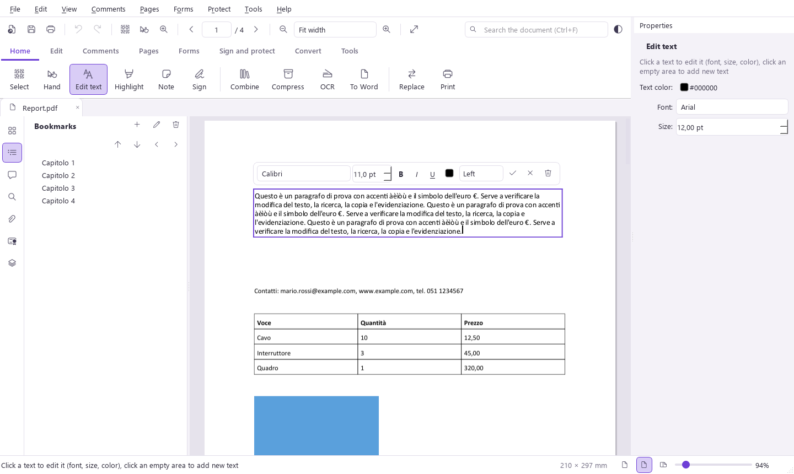
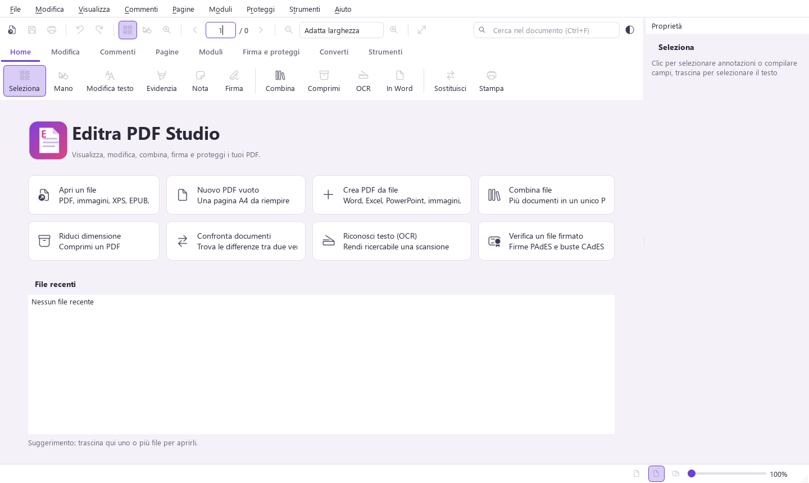
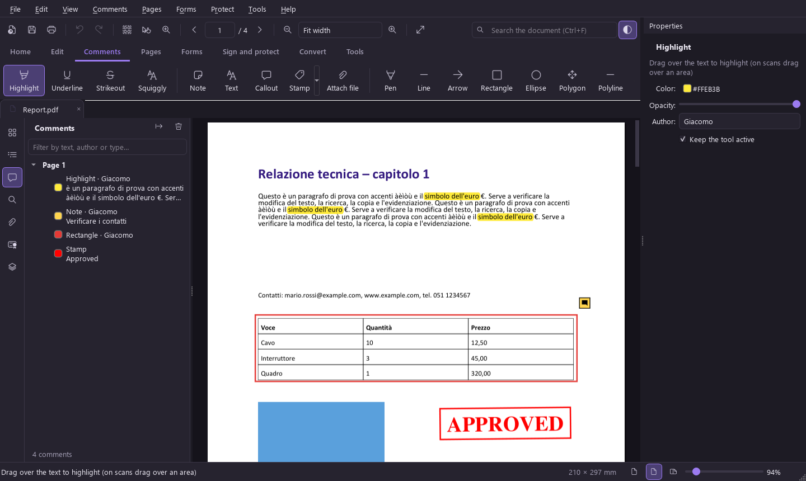
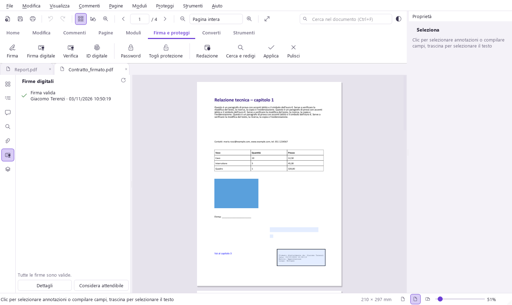

# Editra PDF Studio

**A free, open-source PDF reader and editor for Windows.**
View, edit, annotate, organize, sign, protect, OCR and convert PDF files, all in one desktop app,
with no subscription, no account and no cloud upload.

[⬇ Download the latest release](../../releases/latest) · Windows 10/11 (64-bit) · Italian interface



## Features

**View**
- Tabs, continuous / single / two-page layouts, fit width or page, zoom to area, Ctrl+wheel zoom
- Thumbnails, bookmarks, layers, attachments, full-text search with hit highlighting
- Full screen, presentation mode, night reading mode, light and dark theme, read aloud

**Edit**
- Click any text block to edit it: every installed Windows font, size, bold, italic, underline,
  color, alignment. The original embedded font is reused when it has all the glyphs
- Add new text anywhere, find and replace that keeps font, size and color, move or delete text blocks
- Insert, move, resize, rotate, replace, extract and delete images; paste images or text from the clipboard
- Watermarks (text or image), backgrounds, headers and footers, page numbers, Bates numbering, links

**Comment**
- Highlight, underline, strikeout, squiggly, sticky notes, text boxes, callouts, stamps (built-in and custom)
- Freehand ink, lines, arrows, rectangles, ellipses, polygons, polylines
- Scaled distance and area measurement, file attachments, eraser, comment summary, flattening

**Pages**
- Merge files (PDF, images, Office documents), split by pages / ranges / bookmarks / file size
- Insert, delete, extract, duplicate, replace, rotate, drag-and-drop reordering in the thumbnails
- Crop, resize to another paper format, N-up, interleave front/back scans, remove blank pages, page labels

**Forms**
- Fill in forms; create text fields, checkboxes, radio buttons, combo boxes, list boxes, buttons, signature fields
- Automatic field detection, export/import form data (JSON), reset, flatten

**Sign and protect**
- Handwritten signatures: draw, type in a script font, or import an image
- Digital signatures with a .pfx/.p12 certificate (PAdES), incremental saving keeps existing signatures valid
- Signature validation for PDF files and Italian **.p7m (CAdES)** envelopes: integrity, signer, time, trust,
  changes made after signing
- Create a self-signed digital ID
- Password protection and permissions (AES-256), redaction with pattern search
  (e-mails, phone numbers, IBAN, Italian tax codes…), removal of hidden information

**Convert and tools**
- Export to Word (.docx), Excel (.xlsx), images (PNG, JPEG, TIFF, WEBP), text, HTML, Markdown
- Create PDFs from images, text, HTML, XPS, EPUB and Office files (Office or LibreOffice required for the latter)
- OCR with the engine built into Windows: scanned pages become searchable and selectable, offline
- File size reduction, document comparison with highlighted differences, snapshot tool, print with preview

| | |
|---|---|
|  |  |
|  | |

## Install

Download `EditraPDFStudio_Setup_<version>.exe` from the [Releases](../../releases) page and run it.
No administrator rights are required. A portable `.zip` is also available: extract it anywhere and run
`EditraPDFStudio.exe`.

The executable is not code-signed, so Windows SmartScreen may show a warning the first time:
choose **More info › Run anyway**.

## Build from source

Requirements: Windows 10/11 64-bit, Python 3.13, [Inno Setup 6](https://jrsoftware.org/isinfo.php) for the installer.

```
py -3.13 -m venv .venv
.venv\Scripts\python.exe -m pip install -r requirements.txt
.venv\Scripts\python.exe EditraPDFStudio.pyw
```

Full build (tests, executable, installer, portable zip):

```
powershell -ExecutionPolicy Bypass -File build\build.ps1
```

Tests: `tests/test_ops.py` checks the PDF operations (118 checks); `tests/test_gui.py` drives the
interface with simulated mouse and keyboard input (122 checks). Both run headless.

### Project layout

| Path | Content |
|---|---|
| `editra/ops/` | PDF operations without UI: text editing, pages, annotations, images, forms, security, signatures, OCR, conversion, comparison, compression |
| `editra/view.py` | Page view, rendering, mouse tools |
| `editra/editors.py` | In-place text editors |
| `editra/panels.py` | Side panels |
| `editra/mainwindow.py` | Main window, menus, commands |
| `build/` | PyInstaller spec, Inno Setup script, build script |

## Known limitations

- Edited text is laid out again with the chosen font, without the original kerning, so a line can end up
  slightly wider or narrower. Text rotated by angles other than multiples of 90° cannot be edited.
- Signature validation is offline: certificate revocation (OCSP/CRL) is not checked.
  Smart cards and remote signing are not supported; signing requires a .pfx/.p12 file.
- PDF/A conversion and accessibility tagging are not available.
- The interface is in Italian.

## How it was made

Editra PDF Studio was designed and built by Giacomo Terenzi with the help of an AI coding assistant
(Claude), as an experiment in human + AI software engineering.

## License

Copyright (C) 2026 Giacomo Terenzi

Editra PDF Studio is free software: you can redistribute it and/or modify it under the terms of the
[GNU Affero General Public License](LICENSE) as published by the Free Software Foundation, either
version 3 of the License, or (at your option) any later version. It is distributed in the hope that it
will be useful, but WITHOUT ANY WARRANTY; without even the implied warranty of MERCHANTABILITY or
FITNESS FOR A PARTICULAR PURPOSE.

The PDF engine, MuPDF, is AGPL-licensed, so the whole program is too.
See [THIRD_PARTY_NOTICES.md](THIRD_PARTY_NOTICES.md) for the components used.

---

## In italiano

Editra PDF Studio è un lettore ed editor PDF gratuito e open source per Windows: modifica del testo,
commenti, organizzazione delle pagine, moduli, firme digitali (anche verifica dei file **.p7m**), password,
redazione, OCR, conversione in Word ed Excel. Si scarica dalla pagina [Releases](../../releases).
La guida in italiano è in [LEGGIMI.md](LEGGIMI.md).
